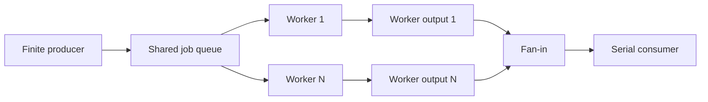

# Fan-out, fan-in, and cancellable pipelines

Extend the [concurrency fundamentals](../01-concurrency/README.md) with bounded
parallel stages, merged streams, early consumer exit, and error propagation.
Read chapter 14's [Context lesson](../../14-context/01-context/README.md) first.
This directory stays in book chapter 12 by topic, while its cancellation protocol
builds on that later prerequisite.

## Run and validate

Run from the repository root:

```sh
go run ./chapters/12-concurrency/02-concurrency-patterns
go run -race ./chapters/12-concurrency/02-concurrency-patterns
go test -race -timeout=30s ./chapters/12-concurrency/02-concurrency-patterns
go vet ./chapters/12-concurrency/02-concurrency-patterns
```

Exercise the protocol under more scheduling combinations:

```sh
go test -race -count=5 -cpu=1,2 -timeout=60s ./chapters/12-concurrency/02-concurrency-patterns
```

The finite program needs no files or network. It demonstrates complete processing,
a full output queue, a consumer that stops after one result, a worker error,
and a caller deadline. Worker assignment and arrival order may vary; the first
section sorts by input position only for display. The real five-millisecond
deadline has no competing work-ready event. No `Sleep` establishes coordination.

## Read the example

- [pipeline.go](pipeline.go) defines value messages, options, the owning runner,
  the finite source, workers, and a checked arithmetic callback.
- [merge.go](merge.go) forwards distinct result streams into a bounded shared
  output and closes it after every forwarder returns.
- [main.go](main.go) runs six sections, including explicit queue handshakes and
  early termination with a recognizable consumer signal.
- [pipeline_test.go](pipeline_test.go) checks exactly-once full results, worker
  limits, backpressure, errors, deadlines, context ownership, and joined cleanup.
- [merge_test.go](merge_test.go) checks merged values, absent inputs, closure,
  and cancellation during both receive and send blocking points.

## Choose a pattern for the communication shape

| Pattern | When to use it | Contract in this lesson |
| --- | --- | --- |
| Pipeline | Different stages should pass intermediate values between them. | A finite producer feeds a parallel transform stage, then one consumer. |
| Fan-out | Independent jobs should be distributed among a bounded number of processors. | Workers compete for one input queue; each received job belongs to one worker. |
| Fan-in | Distinct streams should be consumed through one stream. | One forwarder per input merges worker outputs in unspecified arrival order. |
| Fixed worker pool | A batch may be large, but simultaneous processing must stay bounded. | Exactly the configured number of worker goroutines serve that batch. |
| Backpressure | A slow downstream stage should limit upstream progress. | Bounded queues fill, then sends wait instead of growing without a limit. |



Fan-out here distributes work; it is not a broadcast to every receiver. If every
subscriber needs every value, that is a different delivery contract. A worker
can receive several jobs or none, so callers cannot depend on fair distribution.

The earlier worker pool already uses a shared results channel. That is a simpler
choice when workers can all send directly to the same output. This lesson uses
distinct worker streams so fan-in is explicit; merging existing independent
streams is a reason to use the forwarding stage. It is not a requirement to add
one relay goroutine to every worker pool.

## Own cancellation and completion in one place

`runPipeline` validates options and callbacks before starting stages, rejects a
pre-canceled caller, and returns immediately for an empty valid batch. It derives
a child with `WithCancelCause`, starts the stages, and consumes while they run.
Its deferred cleanup cancels the child and joins **every owned stage** on each
return path. Successful cleanup does not turn a successful return into Canceled.

| Stream | Sender(s) | Closing owner |
| --- | --- | --- |
| Shared jobs | Producer | Producer. |
| Each worker output | That worker | That worker. |
| Merged output | Fan-in forwarders | Coordinator, after all forwarders have returned. |

The pipeline's wait group includes the producer, workers, forwarders, and closing
coordinator. All task registration occurs before the owner waits. The fan-in
coordinator uses a separate wait group for its own senders. Waiting on the entire
pipeline from inside that coordinator would include waiting for itself.

Blocking receives and sends observe `ctx.Done()`. Cancellation during a blocked
send is just as necessary as cancellation during a receive or processing call.
A consumer can therefore stop without draining the remaining stream. Closing a
shared data channel from the consumer would violate sender ownership; canceling
the operation leaves closure to the stages that know when sending has ended.

The owner consumes concurrently with the stages. Waiting for producers/workers
to finish before receiving their unbuffered results could deadlock. A closed
output alone also does not necessarily acknowledge all deferred stage cleanup;
the runner waits for that completion before returning.

## Errors and early exit are part of the API

`process(ctx, job)` can run concurrently up to the worker count. If it returns
an error, its accompanying numeric value is discarded and the worker cancels
with a wrapped cause containing input and worker information. `errors.Is`
still identifies the original domain error.

`consume(ctx, result)` runs serially in the caller. Its error cancels the same
operation. The example returns a local `stopAfterFirst` sentinel when it has
enough data, then recognizes that expected signal with `errors.Is`. The runner
still returns that cause; it does not silently turn all consumer failures into
success. A consumer may choose another explicit stopping policy in its own API.

The first cancellation cause wins, including parent cancellation, worker errors,
and consumer errors. Concurrent failures have no input-order priority, and this
API does not aggregate every error. A parent's custom cancellation cause is
returned as that cause; it need not also match `context.Canceled`. Ordinary
cancellation and deadlines retain their normal standard causes.

Initial context checks reject already canceled work, but cannot make cancellation
atomic with a later receive or callback. Ready progress and cancellation cases
can race. A worker may already have received another job before a consumer
requests early exit; the protocol stops and joins that in-flight work rather
than promising it never started.

Already consumed values, callback side effects, and partial writes are not rolled
back. This is a coordination API, not a transaction or an automatic retry
mechanism. Both callbacks must eventually return and must not panic. A blocking
callback must observe its context or use another bounded cooperative protocol.
The owner waits for callbacks rather than abandoning their goroutines;
cancellation cannot forcibly preempt arbitrary application code.

## Bound the resource that matters

`Workers` limits concurrent processor calls. `QueueCapacity` separately sets each
stage queue's capacity. Zero means an unbuffered rendezvous, not unlimited buffering.
Choose the worker count from the actual CPU, I/O, connection, or service budget;
more workers do not guarantee faster execution.

For `W` workers and capacity `Q`, the stage queues have total capacity
`Q * (W + 2)`: one source queue, `W` worker output queues, and one merged queue.
Stages can also hold values outside those queues. There are `2*W + 2` pipeline
stage goroutines for a nonempty batch: producer, workers, forwarders, and the
closing coordinator. Callback-owned memory or extra goroutines are separate
responsibilities.

The input slice is already retained for this batch and must remain unchanged
until the runner returns. `Job` and `Result` contain scalar fields; channel sends
copy them. Pointer, slice, or map fields would require explicit ownership or
synchronization for the referenced data. The serial consumer owns any result
collection it chooses to create. Collecting/sorting all results, as the display
example does, still costs memory proportional to the batch.

The checked square callback accepts only values from -1,000 through 1,000, keeping
its arithmetic portable even on 32-bit systems. That is the exercise's domain
policy, independent of the pipeline's general callback protocol.

## Backpressure is visible without a timing guess

The standalone fan-in demonstration has one unbuffered input and an output queue
of capacity two. Before starting the consumer, main sends three values. The third
input handshake proves the forwarder received it after enqueuing the first two.
The forwarder must then wait for output space; a fourth input send would wait
behind it. Draining the output releases progress and lets normal closure finish.

Main observes queue length only while it is the sole receiver and has not begun
receiving. It does not use a concurrent `len` check to decide whether sending is
safe. In the pipeline test, a consumer pauses behind an explicit gate and
`synctest.Wait` establishes that the other stages are blocked. With unbuffered
queues, at most one result per worker and forwarder, plus the consumer's result,
can have progressed that far. Resuming the consumer completes all 100 jobs.

Buffers absorb a bounded burst; they do not fix a sustained producer/consumer
rate mismatch. This example deliberately blocks when queues are full. Rejection
or dropping would require a different, documented delivery policy.

## Ordering and scheduling

Successful processing produces one result per input position, including when
application job IDs repeat. Arrival order and worker assignment are unspecified.
`Result.Index` lets a caller restore input order when required. Sorting a collected
batch is one choice; a streaming reorder buffer needs its own memory and policy
for missing results. Tests check contents and bounds without requiring round-robin
assignment or a particular worker to win.

The tests use `testing/synctest` to establish blocked states and exercise deadlines
with virtual time. A cleanup gate specifically proves early consumer exit waits
for a processor's final cleanup. The race detector checks executed shared access;
it complements review of closure, cancellation, and ownership.

For other applications, [`golang.org/x/sync/errgroup`](https://pkg.go.dev/golang.org/x/sync/errgroup)
provides task joining, first-error propagation, and a derived context. It is a
separate module. This lesson keeps explicit wait groups and causes to expose
stage ownership and uses only the standard library. An error group still needs
cooperative work and a correct stream-closing/backpressure protocol.

References: [pipelines and cancellation](https://go.dev/blog/pipelines),
[`context`](https://pkg.go.dev/context), [`sync`](https://pkg.go.dev/sync),
and [`testing/synctest`](https://pkg.go.dev/testing/synctest).
