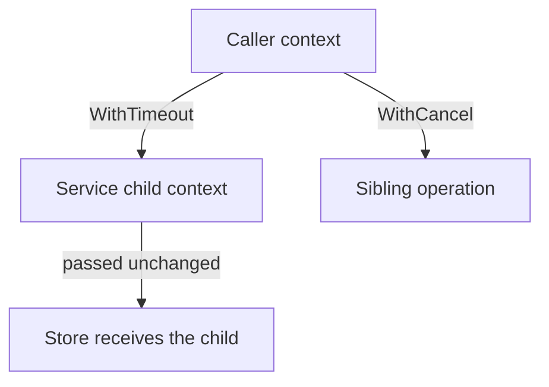

# Context propagation, cancellation, and request values

Practice `context.Context` across function calls, service/dependency boundaries,
and HTTP handlers. This chapter 14 lesson extends chapter 12's cancellation
preview and chapter 13's time, HTTP, and structured logging examples.

## Run and validate

Run from the repository root:

```sh
go run ./chapters/14-context/01-context
go test ./chapters/14-context/01-context
go test -race -timeout=30s ./chapters/14-context/01-context
go vet ./chapters/14-context/01-context
```

Exercise asynchronous paths repeatedly with different scheduler settings:

```sh
go test -race -count=3 -cpu=1,2 -timeout=30s ./chapters/14-context/01-context
```

The example runs eleven finite sections. Work readiness is controlled with
channels; the two real five-millisecond waits illustrate deadline expiration,
not an ordering assumption. The main HTTP section invokes a handler in process
without contacting its example URL. One integration test starts a real loopback
HTTP server to observe request cancellation across that boundary.

## Read the example

- [main.go](main.go) shows roots, values, cancellation trees, joined work,
  deadlines, causes, callbacks, bounded detached work, and handler propagation.
- [reports.go](reports.go) passes contexts through a service into an explicit
  store dependency, deriving a local budget and preserving error causes.
- [values.go](values.go) defines a private comparable key type and typed request
  ID accessors.
- [http.go](http.go) establishes metadata at an incoming boundary, propagates
  `r.Context()`, and explicitly enriches a logger.
- [reports_test.go](reports_test.go) checks propagation, cleanup, pre-canceled
  calls, partial-result rejection, cancellation during a wait, and budget limits.
- [values_test.go](values_test.go) checks absent values, scope, and key isolation.
- [http_test.go](http_test.go) checks handler policy and a client's cancellation
  reaching an already active server-side dependency.

## Choose a root or derive from an existing caller

| Operation | When to use it | Ownership |
| --- | --- | --- |
| `Background` | Establish an application-level root where no caller exists. | It has no deadline, cancellation, or values. |
| `TODO` | Mark a context choice that has not yet been wired through. | It is also non-nil and uncancelable; revisit the propagation decision. |
| `WithCancel` | An owner needs to signal early completion or abandonment. | Call the returned cancel function when that scope ends. |
| `WithTimeout` | Give an operation a relative time budget. | Derive from the caller and release the child even after success. |
| `WithDeadline` | Stop by an absolute instant. | The earlier parent or child deadline applies. |
| `WithValue` | Carry optional request metadata across API boundaries. | Preserve the lineage; provide typed accessors and appropriate value semantics. |

Pass `ctx context.Context` as the first argument. It is an interface passed as a
value; a pointer to that interface is unnecessary. The service stores its store
dependency, while contexts are supplied per operation. Required inputs such as
the report ID and work budget remain ordinary arguments.

Derive from the caller rather than replacing its context with `Background` in
the middle of a call chain. Otherwise the operation loses the caller's deadline,
cancellation, and metadata. Do not pass nil when the appropriate root is not yet
known; use TODO while arranging the actual propagation.

## A context tree carries a lifetime



Canceling the caller reaches both branches. Canceling the service child does
not cancel the caller or its sibling. A service budget cannot extend a shorter
caller deadline. The store receives the derived context and observes its `Done`
channel while waiting.

`Generate` requires a positive budget as an application policy; the context
library itself accepts nonpositive timeouts as immediate expiration. It checks
already canceled input before invoking the store, derives a timeout, and defers
its cancel function. That cancel releases timer/parent references even if the
store succeeds quickly. A test captures the child and verifies it is canceled
after success while the caller remains active.

Always release owned cancel functions on all return paths. They may be called
repeatedly, but calling them does not wait for user work to finish. For repeated
operations in a long-lived loop, use a helper per operation or release each child
promptly rather than retaining every deferred cleanup until the loop ends.

## Cancellation is cooperative; completion is separate

`Done` closing is a stop signal. `Err` then identifies cancellation or deadline
expiration. The store selects between its work gate and `ctx.Done()`. A gate that
is nil keeps work unavailable; a closed gate makes it ready. Background's nil
`Done` channel naturally disables the cancellation case.

The initial `Err` check rejects already canceled work. After that check, work
readiness and cancellation can race, and `select` gives neither case priority.
This contract allows in-flight completion; cancellation is not a transaction
that rolls back completed work.

The owner of the example goroutine cancels and then receives a separate completion
acknowledgment before reading its result. Returning early from the caller or
reaching a deadline does not automatically stop or join a goroutine. The service
and store themselves start no goroutines and return synchronously after their
work or cancellation is observed.

Use context-aware APIs where available, such as `http.NewRequestWithContext`
and `database/sql` methods like `QueryContext`. An arbitrary blocking read or
CPU-bound function does not become interruptible just because it receives a
context. It needs a supported I/O deadline/closure policy, periodic checks, or
another cooperative protocol appropriate to its operation.

## Err and Cause answer different questions

`ctx.Err()` classifies termination as `context.Canceled` or
`context.DeadlineExceeded`. Ordinary wrapped errors remain inspectable with
`errors.Is`. The service discards partial results on error and preserves that
classification through its error wrapping.

`WithCancelCause` records a more specific reason. Its cancel function accepts
an error; passing nil records ordinary cancellation. `WithTimeoutCause` and
`WithDeadlineCause` supply a reason for automatic deadline expiration. Calling
their returned ordinary cancel function early instead records cancellation.
The first cancellation determining a context's outcome fixes its cause, including
inheritance from a parent.

The example shows canceled work with an application shutdown cause and a deadline
with a report-budget cause. Inspect `context.Cause(ctx)` when the reason matters.
Returning a wrapped `ctx.Err()` does not automatically wrap an unrelated custom
cause as well; an API must choose how it exposes that additional information.
These cause APIs are modern additions supported by the course's Go version.

## Values are request metadata, with ordinary data ownership

`withRequestID` adds an immutable string under a private key type. `requestIDFrom`
performs a checked assertion and treats an empty string as absent. A child can
shadow the ID without changing its parent. A distinct key type from another
package cannot collide with this key just because its name is similar.

Suitable values include correlation IDs and other optional request-scoped
metadata. Keep configuration, stores, loggers, and required domain input explicit.
In particular, the report ID is a method argument, not a hidden context dependency.

Context methods support concurrent use; storing a map, slice, or pointer in a
value does not make that referenced data immutable or synchronized. Derivation
also does not deep-copy values. The string here avoids that mutable sharing.

## HTTP propagation has an incoming and an outgoing boundary

The middleware starts with `r.Context()`, reads an optional `X-Request-ID`, and
passes a shallow request copy made by `r.WithContext(ctx)` to the next handler.
The handler reads the typed metadata, enriches its explicit logger, and passes
the request context into `Generate`. The derived service context then reaches
the store. The original request's context is unchanged by the middleware.

Context values, cancellation causes, and deadline metadata are not automatically
serialized onto HTTP requests. A client's `NewRequestWithContext` controls its
local request lifetime. Metadata must be encoded explicitly in a protocol field,
as the request ID header is here. On the server, a disconnected client can cause
the incoming request context to be canceled; this does not imply the server sees
the client's original `DeadlineExceeded` classification or custom cause.

| Report handler outcome | Example HTTP policy |
| --- | --- |
| Success | 200 with JSON and any request ID response header. |
| Local/parent deadline exhausted | 504. |
| Operation canceled | 503, if a response can still be delivered. |
| Report absent | 404. |
| Other service failure | 500. |

The cancellation integration test waits until the store has received its context,
then cancels the actual HTTP client request. It waits for both store and handler
completion, rather than assuming that the client's error alone proves server-side
work ended. The canceled client may not receive a server error response at all.

`slog` receives the context but does not automatically extract its values. The
handler explicitly binds `request_id` to a derived logger, as in the previous
structured logging lesson. Logging cancellation-related information remains
useful after that context has ended.

## Callbacks and separately owned work

`context.AfterFunc` arranges a callback in its own goroutine after cancellation.
Its stop function returns true only when it prevented the callback from starting;
false does not establish that a running callback has completed. The example uses
a separate completion channel and waits for it. Repeated cancellation does not
schedule repeated executions of that registration.

`WithoutCancel`, available since Go 1.21, retains values while removing the
parent's deadline and cancellation. Its `Done` is nil, `Err` and `Cause` are nil,
and `Deadline` reports no bound. Use it only when a different owner deliberately
takes responsibility for work beyond the original lifetime, such as cleanup.
The example gives that work a new timeout and completes it synchronously before
the owner returns. Detached work is not automatically joined or bounded.

## Testing the lifetime contract

Deadline tests use `testing/synctest` to advance controlled virtual time. They
verify both a shorter caller budget and a shorter service budget, with no real
waiting for seconds or hours. Cancellation tests establish that work is blocked
before requesting cancellation and then observe completion. No `Sleep` guesses
determine readiness.

The loopback HTTP test uses explicit start/finish channels. Its five-second
timers are watchdogs for broken protocols, and cleanup can release its fake
dependency even if an assertion fails. The race detector checks executed
concurrent accesses; the explicit ownership protocol still needs review.

References: [`context`](https://pkg.go.dev/context),
[context introduction](https://go.dev/blog/context),
[contexts and structs](https://go.dev/blog/context-and-structs),
[`net/http`](https://pkg.go.dev/net/http),
and [`testing/synctest`](https://pkg.go.dev/testing/synctest).
