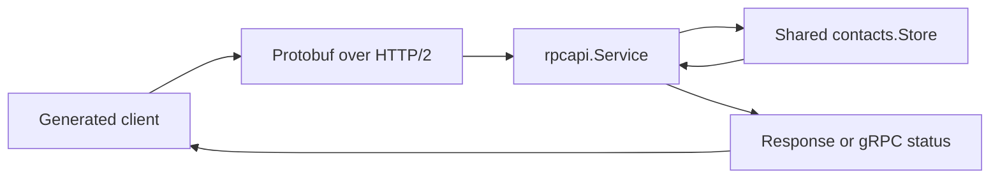

# Unary contacts service

Read the [Protobuf foundation](../01-protobuf/README.md) first. You can already
encode and decode messages locally. Now send one to a server that performs a
contact operation and returns its result. A **unary** call sends one request
and completes with one response or a failure status.

## Run and validate

From the repository root:

```sh
go -C extensions/01-protobuf-and-grpc run ./02-unary
```

The default demo binds an available loopback TCP port, starts its server, runs
the client examples, closes the client channel, and waits for server shutdown.
It exits by itself. It demonstrates creation, duplicates, retrieval, selected
updates, stale versions, full replacement, paged listing, field-level validation
details, caller cancellation, expired deadlines, and deletion.

## Learn in passes

| Pass | Focus | Check your understanding |
| --- | --- | --- |
| 1 | Find `CreateContact`, `GetContact`, and `Duplicate name` in the output. | Explain which calls change data and why the duplicate fails. |
| 2 | Follow one create through [client.go](client.go), [service.go](../rpcapi/service.go), and the shared store. | Distinguish gRPC's encoding/decoding work from the contact rules in our code. |
| 3 | Compare Replace and Update, then inspect the version/error examples. | Predict which fields are cleared and why a stale edit returns `Aborted`. |
| 4 | Read channel/context ownership, then try separate processes and the tests. | Explain who closes the channel and how a deadline reaches the server. |

On the first pass, focus on these summaries rather than the changing version
strings and name suffixes:

```text
CreateContact -> OK
Duplicate name -> AlreadyExists
GetContact -> OK
```

## Terms used in one call

| Term | Meaning here |
| --- | --- |
| RPC | A request asking another process to run a named operation. A Go method call starts it, but the network call can fail. |
| Generated client | Typed methods produced from the `.proto` contract; they ask gRPC to send/receive the messages. |
| Channel (`grpc.ClientConn`) | A reusable object that manages connections and calls to a target. It can manage more than one underlying connection. |
| Service / handler | The server's Go implementation of an operation, such as `Service.CreateContact`. |
| Status | The RPC's outcome, such as `OK`, `AlreadyExists`, or `InvalidArgument`. |
| Deadline | The latest time the caller is willing to wait. The call's context carries it to the server. |

The generated client looks like an ordinary Go API, while gRPC handles binary
Protobuf messages over HTTP/2 underneath. The server still needs application
code to validate input and perform the requested operation.

## Follow one call

Trace a create on a fresh server, omitting the demo's per-run name suffix:

```text
Input message: CreateContactRequest{Input: ContactInput{Name: " Ana "}}
Generated client/gRPC: encode the request and send CreateContact
gRPC server: decode the bytes into a request message
rpcapi.Service: require an input message, then call the shared store
contacts.Store: trim the name to "Ana", check uniqueness, assign ID 1
rpcapi.Service: build a Contact message with ID/name/version
Client result: Contact{id: 1, name: "Ana", ...}, nil error, status OK
```

The field notation above is a data sketch, not a standalone Go program. The
demo uses pointers to the generated messages. A second create of that same
normalized name returns `AlreadyExists`; it does not add another contact.
The server's store defines the contact rules, while the RPC adapter translates
requests and domain errors into messages and statuses.



- [client.go](client.go) creates one `grpc.ClientConn`, constructs the generated
  client, sets a fresh context budget for each call, inspects status codes and
  typed details, and closes the channel at the end. ProtoJSON is used only for
  displaying results; the network calls use protobuf binary.
- [service.go](../rpcapi/service.go) implements the generated service interface.
  It embeds `UnimplementedContactServiceServer`
  by value and receives a consumer-defined `Store` interface.
- [input.go](../rpcapi/input.go) maps field masks, optional versions, and list
  parameters into ordinary Go domain values.
- [errors.go](../rpcapi/errors.go) maps domain/context errors to gRPC status
  codes and attaches `google.rpc.BadRequest` field details to validation errors.
- [main.go](main.go) owns application mode, signals, and a fresh shutdown budget.
  [rpcserver](../internal/rpcserver/server.go) owns Serve and graceful-stop
  goroutines and waits for completion.

The lab's `go.mod` uses a local replacement for the main course module. It
imports the existing [contacts package](../../../chapters/13-standard-library/06-project-rest-api/contacts/model.go)
without importing the REST handlers into the service. Business validation,
stable IDs, name uniqueness, snapshots, paging, and atomic version checks remain
in that shared package.

Reusing a package does not share memory between processes. The ordinary REST
and gRPC commands each create their own store. A test hosts both adapters over
the same `*contacts.Store`, proving that either adapter can observe and invalidate
versions after the other's changes.

## Request and update rules

Start with one contact: name="Ana", email="old@example.com", phone="555-0100".
Compare these operations independently from that starting state:

| Request | Result |
| --- | --- |
| Replace with input name="Ana Updated" | Changes the name and clears email/phone because every editable field is replaced. |
| Update with empty input and mask `["email"]` | Clears email, keeping the current name and phone. The mask selects the empty value. |

| Request | Behavior |
| --- | --- |
| Create | Requires input and a valid nonblank name; returns the assigned ID and version. |
| Get | Requires a positive ID; returns an independent protobuf representation. |
| List | Zero limit selects 20, maximum is 100; offset must be nonnegative and fit Go int. Unspecified sort selects increasing ID. Unknown enum values are rejected. |
| Replace | Requires input; replaces all editable fields and clears omitted/zero-valued optional data. |
| Update | Requires input and a nonempty mask; changes only selected fields. |
| Delete | Removes an existing ID and returns the dedicated empty response. |

The mask accepts only `name`, `email`, and `phone`, with no duplicates, nested
paths, or wildcard. Selected empty email/phone values clear those fields;
unselected values are ignored, including supplied conflicting names. Selecting
blank name or a duplicate rename rejects the whole operation. Missing resources
remain missing; Replace and Update do not create them.

The list response includes total matches, the effective limit/offset, and an
optional next offset. Check `NextOffset != nil` before following it. Repeated
fields can decode as nil when empty; use their length/getters rather than
assuming a non-nil slice. ProtoJSON display omits default values such as offset
0 and empty repeated fields. The [collection-query rules](../../../chapters/13-standard-library/06-project-rest-api/collection-queries.md)
still govern filtering, ordering, snapshots, and changes between pages.

### Versions and errors

`expected_version` is optional on Replace, Update, and Delete. Absent means
unconditional. Present but empty is InvalidArgument. Copy a nonempty version
from a previous Contact; the server treats it as opaque text and does not trim
it or interpret HTTP quotes, prefixes, or wildcards.

The service passes that condition to the store's atomic operation, rather than
performing a separate Get followed by a write. Two changes using the same old
version cannot both succeed when the first changes its content. A no-op retains
the version because it identifies content rather than counting writes.

This is an **optimistic concurrency** check: send the version you read, and
the server checks whether it is still current before saving the edit. An
**atomic** check/write means another write cannot slip between those two steps.

| Condition | gRPC code |
| --- | --- |
| Invalid input, mask, enum, ID, or present empty version | `InvalidArgument` |
| Missing ID | `NotFound` |
| Duplicate normalized name | `AlreadyExists` |
| Stale expected version | `Aborted` |
| Exhausted ID space | `ResourceExhausted` |
| Caller/store cancellation or deadline | `Canceled` / `DeadlineExceeded` |
| Unexpected backend failure | `Internal` with a generic message; details stay in server logs. |

Aborted describes this compare-and-set concurrency conflict. Read the current
state and reconsider the edit before retrying the read/modify/write sequence.
The demo does not configure an application retry policy. Validation errors
include typed BadRequest details, such as `input.name` or `update_mask`; clients
can inspect `status.Convert(err).Details()` rather than parse error text.

These are RPC statuses rather than HTTP resource statuses or Problem Details
bodies. A returned Contact always includes its domain version, including after
Replace; HTTP PUT's validator restriction applies to the HTTP adapter's headers.
Malformed protobuf or invalid UTF-8 can fail in the framework's codec before
application validation, so those failures need not have application field details.

The generated client returns a non-nil Go error for a failed RPC. The demo's
`call` helper checks that error against the expected status and returns nil to
let the lesson continue when the expected failure occurred. That nil means
the example's check passed; the original RPC still failed with its shown code.

## Channel, context, and shutdown ownership

`grpc.NewClient` creates a reusable channel and performs connection work lazily.
Construction succeeding is not a connectivity check. Calls use their own
context deadlines; the demo gives each call up to two seconds and cancels its
timer promptly. One channel and generated client support concurrent calls;
construct separate request messages for concurrent mutable inputs.

The server passes the incoming call context to every store operation. The demo's
pre-canceled/expired examples show caller-side statuses. Controlled tests also
hold a call inside the store until its incoming context is canceled or expires,
proving in-flight propagation after the connection is established.

A deadline limits how long the caller waits; it does not roll back a completed
mutation or preempt arbitrary Go code. An ambiguous transport/deadline failure
can occur after a write committed. Handlers must cooperate with cancellation.

The application initiates `GracefulStop`, which stops accepting new calls and
waits for active RPCs. After the independent three-second grace budget expires,
it calls `Stop`, canceling active RPC contexts and closing connections. This
server enables `WaitForHandlers(true)` in the pinned gRPC-Go version, so Stop
also joins handlers. A handler that ignores cancellation can still delay exit;
the timeout does not forcibly terminate goroutines. The owner waits for both
shutdown and Serve completion, preserving errors from the fallback.

## Separate server and client

After following the finite demo, keep a server running in one terminal:

```sh
go -C extensions/01-protobuf-and-grpc run ./02-unary -serve
```

Run the generated-client examples in another terminal:

```sh
go -C extensions/01-protobuf-and-grpc run ./02-unary -target 127.0.0.1:50051
```

Stop the server with Ctrl+C. Use `-addr 127.0.0.1:50052` with `-serve` to choose
another port, then pass that address to the client. The default address is
`127.0.0.1:50051`. This port speaks gRPC; the provided typed client is the
interactive tool for this stage. Reflection and grpcurl follow in stage 4.

The examples use a per-run name suffix and delete their contacts on successful
completion. Interrupted calls against a persistent server process can leave
contacts behind. Data belongs to that process and disappears on restart.
This local stage uses plaintext transport credentials; TLS and authentication
are part of the infrastructure stage.

## What the tests establish

After tracing the basic calls, run the checks:

```sh
go -C extensions/01-protobuf-and-grpc test -count=1 -timeout=30s ./...
go -C extensions/01-protobuf-and-grpc test -race -count=3 -cpu=1,2 -timeout=45s ./...
go -C extensions/01-protobuf-and-grpc vet ./...
go -C extensions/01-protobuf-and-grpc mod tidy -diff
```

- [Service tests](../rpcapi/service_test.go) use bufconn for a real in-memory
  HTTP/2/protobuf/status exchange: CRUD, masks, field details, page metadata,
  versions, rejected mutations, and competing writers.
- [Context/integration tests](../rpcapi/context_test.go) check in-flight
  cancellation/deadlines, private-error redaction, and shared REST/RPC data.
- [Shutdown tests](../internal/rpcserver/server_test.go) hold an active handler,
  observe listener closure, and verify normal draining or forced cancellation
  and handler completion. Coordination uses channels, not Sleep guesses.
- [Command tests](main_test.go) run the finite demo and separate server/client
  functions over real loopback TCP, then wait for cleanup. They also check lazy
  channel construction and a controlled unavailable transport.

bufconn avoids port allocation and external services while retaining gRPC's
actual serialization and dispatch. TCP tests complement it with real sockets.
Repeated race checks cover executed schedules; they do not prove every timing
or failure condition. Continue with the [streaming stage](../03-streaming/README.md).
TLS/auth, metadata/interceptors, and health are covered in the
[infrastructure stage](../04-infrastructure/README.md). Retry/size policies
are covered in [stage 5](../05-resilience/README.md).

References: [`grpc.NewClient`](https://pkg.go.dev/google.golang.org/grpc@v1.85.0#NewClient),
[status codes](https://grpc.io/docs/guides/status-codes/),
[deadlines](https://grpc.io/docs/guides/deadlines/),
[graceful shutdown](https://grpc.io/docs/guides/server-graceful-stop/), and
[bufconn](https://pkg.go.dev/google.golang.org/grpc/test/bufconn).
