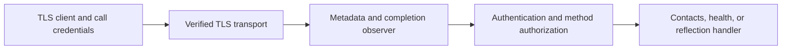

# gRPC service infrastructure

Read [streaming](../03-streaming/README.md) first. This stage adds metadata,
interceptors, completion logging, verified TLS, authentication/authorization,
health checks, and optional reflection around the existing contact service.
The contact rules and Protobuf contract remain unchanged.

## Run from the repository root

```sh
go -C extensions/01-protobuf-and-grpc run ./04-infrastructure
go -C extensions/01-protobuf-and-grpc test -count=1 -timeout=30s ./...
go -C extensions/01-protobuf-and-grpc test -race -count=3 -cpu=1,2 -timeout=45s ./...
go -C extensions/01-protobuf-and-grpc vet ./...
```

The finite demo generates a local CA, server certificate, and random reader/
writer tokens in memory. It starts a loopback TLS server, exercises permitted
and rejected calls, inspects metadata/health/reflection, deletes its contacts,
and shuts down. No certificate installation, protoc, grpcurl, or external
identity provider is needed for this default run.

Server logs and client output appear together. Completion logs show the method,
call kind, request ID, status, and handler duration. The demo synchronizes writes
because both server and client can write concurrently.

## Separate server and client

First create certificates in a **new** directory; its parent must exist:

```sh
go -C extensions/01-protobuf-and-grpc run ./04-infrastructure \
  -init-tls /tmp/golang-course-grpc-tls
```

This writes `ca.pem`, `server.pem`, and `server-key.pem`. It refuses an existing
directory rather than replacing keys. Certificates expire after 24 hours;
generate a new directory when they expire. File creation can leave a partial
directory if setup fails. These files are runtime lab material, outside Git.

In the server terminal, set two distinct example credentials and start:

```sh
export GRPC_LAB_READER_TOKEN='reader-local-demo'
export GRPC_LAB_WRITER_TOKEN='writer-local-demo'
go -C extensions/01-protobuf-and-grpc run ./04-infrastructure \
  -serve -tls-dir /tmp/golang-course-grpc-tls -reflection
```

In a second terminal, set the same two environment variables and run:

```sh
export GRPC_LAB_READER_TOKEN='reader-local-demo'
export GRPC_LAB_WRITER_TOKEN='writer-local-demo'
go -C extensions/01-protobuf-and-grpc run ./04-infrastructure \
  -target 127.0.0.1:50052 -tls-dir /tmp/golang-course-grpc-tls -reflection
```

The finite client exercises both roles, so it needs both credentials. Each role
uses its own reusable channel. Names have a per-run suffix; successful runs
delete their contacts, while failed/interrupted runs may leave data. The server
stores data only in memory. Stop it with Ctrl+C. Use `-addr` and a matching
`-target` to change the port. Stages 2 and 3 keep their earlier plaintext demos;
use this stage's TLS client for the new endpoint.

Standalone reflection is off by default. Add `-reflection` to both commands
above to enable it on the server and exercise it in the client. The finite
default demo enables it on its temporary server.

## Read the implementation

- [main.go](main.go) composes transport credentials, interceptor chains, health,
  reflection, and the shared server lifecycle. Registration finishes before Serve.
- [client.go](client.go) creates TLS channels and reads headers/trailers after
  observing call completion. Stream opening alone still cannot establish success.
- [auth.go](../internal/rpcinfra/auth.go) verifies bearer credentials, assigns an
  identity, and applies one explicit method policy to both unary and stream calls.
- [observe.go](../internal/rpcinfra/observe.go) validates/generates request IDs,
  adds response metadata, and records one completion entry per intercepted RPC.
- [certificates.go](../internal/labtls/certificates.go) creates and loads the local
  TLS material using the standard library.
- [server.go](../internal/rpcserver/server.go) retains graceful draining and
  forced-stop handler joining; its optional config adds the standard services.



TLS setup belongs to transport credentials. Interceptors run per RPC, after
transport setup. The first interceptor in each chain is outermost, so the
observer also records authentication/authorization failures. A stream interceptor
runs around the entire stream handler, rather than around each message. See the
[interceptor guide](https://grpc.io/docs/guides/interceptors/).

## Metadata and context

The client can attach one `x-request-id`: 1–64 ASCII letters, digits, `_`, or `-`.
If absent, the server generates one. Empty, duplicate, oversized, or malformed
IDs fail with `InvalidArgument`. Request IDs correlate logs; clients can choose
them, so they are not proof of identity.

The response header echoes `x-request-id`; the custom trailer `x-rpc-kind`
identifies `unary` or `stream`. These are teaching metadata, separate from the
standard gRPC final status. Unary clients use `grpc.Header`/`grpc.Trailer` call
options. Streaming clients read `Header()` and read `Trailer()` only after
`Recv` returns its terminal EOF/error or `CloseAndRecv` finishes. The
[metadata guide](https://grpc.io/docs/guides/metadata/) explains the header/trailer
side channel; it does not replace request and response messages.

Unary interceptors pass a derived context to the next handler. Stream
interceptors wrap `grpc.ServerStream` and override `Context()`, delegating the
transport methods. Both preserve deadlines, cancellation, metadata, and peer
information. The authenticated identity contains a subject and its role, using
a private context key; a client cannot elevate its role by sending `x-role: writer`.

Completion logs use a selected set of fields. They exclude tokens, raw
authorization metadata, contact payloads, and error text. Duration measures
server handler/interceptor work, rather than the client's whole latency.
Transport failures before handler dispatch are outside these interceptors;
metrics and tracing follow in stage 5.

## TLS and access policy

The server presents a CA-signed certificate with SANs for `localhost`,
`127.0.0.1`, and `::1`. The client trusts only the supplied local CA and verifies
the target hostname/IP. TLS 1.3 is required. A wrong CA, wrong hostname, or
expired certificate fails verification. `InsecureSkipVerify` is never enabled.
The CA private key is discarded after signing; the client needs only `ca.pem`.
The server's private key is written with owner-only permissions on POSIX systems.

This is server-authenticated TLS plus a bearer credential identifying the
caller. It does not request client certificates. `BearerToken` implements
`credentials.PerRPCCredentials`; `RequireTransportSecurity()` returns true, so
gRPC refuses to attach it to a plaintext channel. See the
[authentication guide](https://grpc.io/docs/guides/auth/) and
[call credentials API](https://pkg.go.dev/google.golang.org/grpc/credentials#PerRPCCredentials).

| RPC group | No token | Reader | Writer |
| --- | --- | --- | --- |
| Health `Check` | Allowed over TLS | Allowed | Allowed |
| Contact get/list/server stream/bidirectional lookup | `Unauthenticated` | Allowed | Allowed |
| Contact create/replace/update/delete/client-stream import | `Unauthenticated` | `PermissionDenied` | Allowed |
| Health `List` and `Watch` | `Unauthenticated` | Allowed | Allowed |
| Reflection v1/v1alpha, when enabled | `Unauthenticated` | `PermissionDenied` | Allowed |

Missing, malformed, duplicate, or unknown credentials yield `Unauthenticated`.
A verified identity with insufficient permissions receives `PermissionDenied`.
Future registered RPCs require an explicit policy entry. Disabling reflection
removes its service entirely, resulting in `Unimplemented` for those RPCs.

The two static credentials are a small teaching verifier. They remain fixed for
the server lifetime; authentication/authorization occur once per RPC, including
long-lived streams. This example does not implement token expiry/revocation,
JWT/OAuth, tenant policies, or a secret manager. A real identity system should
replace the verifier while retaining the transport/interceptor boundaries.

## Health, reflection, and shutdown

The standard health service reports `SERVING` for the whole server (`""`) and
`contacts.v1.ContactService` once the in-memory service is usable. `Check` is
unary; `Watch` is a long-lived stream of status changes. Unknown services return
`NotFound` for Check. Health describes application readiness; it is separate from
TLS connectivity or process liveness. Publishing a status alone does not block
contact RPCs. This client demonstrates direct Check/Watch calls; it does not
configure automatic client-side health gating.

Before graceful shutdown, the helper calls `health.Shutdown()` to publish
`NOT_SERVING`. A Watch remains open after that update. Cooperative clients
cancel subscriptions; otherwise the shutdown budget triggers Stop, which
cancels and joins active handlers. Publishing NOT_SERVING alone does not close
the stream. See [health checking](https://grpc.io/docs/guides/health-checking/).

Reflection publishes service/message descriptors for inspection tools. It uses
ordinary authenticated streaming RPCs in this lab, supports both v1 and
v1alpha, and requires explicit server opt-in. It exposes the nine contact RPCs
without changing the contact schema. It is a different facility from Go's
`reflect` package. Follow the [grpcurl exercises](grpcurl.md) to list/describe
services and invoke unary and streaming calls with verified TLS. See the
[reflection guide](https://grpc.io/docs/guides/reflection/).

## Validation and next stage

Tests use real loopback TLS connections, check both roles across call shapes,
reject untrusted CAs/hostnames and plaintext call credentials, inspect metadata,
verify log redaction, and preserve identity/deadlines/cancellation through both
interceptor chains. Health tests observe status transitions and graceful/forced
shutdown with an active Watch. Reflection tests cover opt-in and both protocol
versions. Certificate tests check expiry and refusal to replace existing keys.
All earlier stages remain part of the module's test/race run.

Before moving on, explain authentication versus authorization, transport
credentials versus call credentials, headers versus trailers, and why an open
health Watch can delay shutdown. The remaining stage covers explicit message
limits, bounded retries/idempotency, observability, failure tests, and final review.
