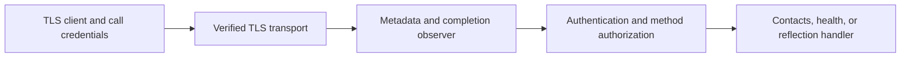

# gRPC service infrastructure

Read [streaming](../03-streaming/README.md) first. You can already create and
retrieve contacts over gRPC. Now add the pieces that control who can call the
service, protect the connection, and help you understand what happened to a call.

Learn the flow of one request first. Then add metadata, TLS, health checks, and
service discovery. Each part uses the same contact operations from earlier stages.

## Run from the repository root

```sh
go -C extensions/01-protobuf-and-grpc run ./04-infrastructure
```

The finite demo generates a local CA, server certificate, and random reader/
writer tokens in memory. It starts a loopback TLS server, exercises permitted
and rejected calls, inspects metadata/health/reflection, deletes its contacts,
and shuts down. No certificate installation, protoc, grpcurl, or external
identity provider is needed for this default run.

Server logs and client output appear together. Completion logs show the method,
call kind, request ID, status, and handler duration. The demo synchronizes writes
because both server and client can write concurrently.

## Learn in passes

Complete one pass before adding the next concept. Keep the working example open
beside the code; the file list below is a map, not a requirement to read every
helper before running a call.

| Pass | Focus | Check your understanding |
| --- | --- | --- |
| 1 | Run the demo and find `Missing token`, `Reader create`, and `Reader get`. | Explain why the three calls have different results. |
| 2 | Follow one call through [main.go](main.go) and [auth.go](../internal/rpcinfra/auth.go). | Point to the check that stops a reader from creating contacts. |
| 3 | Read metadata and TLS below, then [observe.go](../internal/rpcinfra/observe.go) and [certificates.go](../internal/labtls/certificates.go). | Identify the request ID, the trusted CA, and the caller token. |
| 4 | Read health/reflection, then try the separate-terminal and grpcurl exercises. | Distinguish a readiness check from discovering a service's methods. |

On the first pass, read these summary lines among the server logs:

```text
Missing token -> Unauthenticated
Reader create -> PermissionDenied
Reader get -> OK
```

The first caller has not proved its identity. The second is recognized but lacks
permission to create. The third is recognized and is allowed to read. Detailed
log timestamps and durations become useful after that distinction is clear.

## Follow one request through an interceptor

| Term | Meaning in this example |
| --- | --- |
| Handler | The function that performs the requested operation, such as `Service.CreateContact`. |
| Interceptor | A function around the handler that can run shared steps before/after it, or reject the call. |
| Metadata | Extra key/value information attached to a call, such as its token or request ID. Contact fields stay in the request message. |
| `next` | The next function in the chain: another interceptor or the final handler. Calling it lets the request continue. |

The order is `ObserveUnary -> Policy.Unary -> contact handler`. Follow the
reader's rejected create from the demo:

```text
Input: reader token + CreateContact(name="Denied")
ObserveUnary: assign a request ID
Policy.Unary: recognize the reader, reject a write -> PermissionDenied
ObserveUnary: record the result
Outcome: the contact handler was never called; no contact was created
```

With the writer token, the permission check calls `next`, the handler creates
the contact, and the observer records OK after that handler returns. In this
lab, **authentication** verifies which client supplied the token, while
**authorization** checks which operations that client may perform.

For streaming, the same shared steps run around the stream's handler. They run
once for the call; individual messages then pass through that open stream.

## Read the implementation

- [main.go](main.go) composes transport credentials, interceptor chains, health,
  reflection, and the shared server lifecycle. Registration finishes before Serve.
- [client.go](client.go) creates TLS channels and reads headers/trailers after
  observing call completion. Stream opening alone still cannot establish success.
- [auth.go](../internal/rpcinfra/auth.go) verifies bearer credentials, assigns an
  identity, and applies one explicit method policy to both unary and stream calls.
- [observe.go](../internal/rpcinfra/observe.go) validates/generates request IDs,
  adds response metadata, and records one completion entry per intercepted RPC.
- [certificates.go](../internal/labtls/certificates.go) creates and loads the local
  TLS material using the standard library.
- [server.go](../internal/rpcserver/server.go) retains graceful draining and
  forced-stop handler joining; its optional config adds the standard services.



TLS setup belongs to transport credentials. Interceptors run per RPC, after
transport setup. The first interceptor in each chain is outermost, so the
observer also records authentication/authorization failures. A stream interceptor
runs around the entire stream handler, rather than around each message. See the
[interceptor guide](https://grpc.io/docs/guides/interceptors/).

## Metadata and context

For a contact creation, `input.name` describes the contact being created.
An `x-request-id` metadata value labels the call so you can find its log entry.
The response **headers** arrive with its initial metadata; **trailers** arrive
when the RPC ends. Here the header echoes that ID and a trailer names the call kind:

```text
Request metadata:  x-request-id=infra-create
Request message:   input.name="TLS Contact <suffix>"
Response header:   x-request-id=infra-create
Response trailer:  x-rpc-kind=unary
```

The client can attach one `x-request-id`: 1–64 ASCII letters, digits, `_`, or `-`.
If absent, the server generates one. Empty, duplicate, oversized, or malformed
IDs fail with `InvalidArgument`. Request IDs correlate logs; clients can choose
them, so they are not proof of identity.

The response header echoes `x-request-id`; the custom trailer `x-rpc-kind`
identifies `unary` or `stream`. These are teaching metadata, separate from the
standard gRPC final status. Unary clients use `grpc.Header`/`grpc.Trailer` call
options. A streaming client's `Header()` can wait for initial metadata before
the stream ends. Read `Trailer()` after `Recv` returns its terminal EOF/error
or `CloseAndRecv` finishes. The
[metadata guide](https://grpc.io/docs/guides/metadata/) explains the header/trailer
side channel; it does not replace request and response messages.

Unary interceptors pass a derived context to the next handler. Stream
interceptors wrap `grpc.ServerStream` and override `Context()`, delegating the
transport methods. Both preserve deadlines, cancellation, metadata, and peer
information. The authenticated identity contains a subject and its role, using
a private context key; a client cannot elevate its role by sending `x-role: writer`.

Completion logs use a selected set of fields. They exclude tokens, raw
authorization metadata, contact payloads, and error text. Duration measures
server handler/interceptor work, rather than the client's whole latency.
Transport failures before handler dispatch are outside these interceptors;
metrics and tracing are demonstrated in [stage 5](../05-resilience/README.md).

## TLS and access policy

TLS protects the connection and lets the client verify the server's identity.
A **certificate** ties that server identity to a public key. A **CA**
(certificate authority) signs certificates; this demo gives the client the
local CA certificate so it can verify the server's certificate.

The **bearer token** is a separate credential sent on a call. Possessing the
writer token gives the caller the writer identity and its permissions in this
lab. The certificate and token therefore have different jobs: verifying the
server and identifying the caller.

The server presents a CA-signed certificate with SANs for `localhost`,
`127.0.0.1`, and `::1`. The client trusts only the supplied local CA and verifies
the target hostname/IP. Both configs set `MinVersion: tls.VersionTLS13`, and tests
check that TLS 1.3 is negotiated. A wrong CA, wrong hostname, or
expired certificate fails verification. `InsecureSkipVerify` is never enabled.
The CA private key is discarded after signing; the client needs only `ca.pem`.
The server's private key is written with owner-only permissions on POSIX systems.

This is server-authenticated TLS plus a bearer credential identifying the
caller. It does not request client certificates. `BearerToken` implements
`credentials.PerRPCCredentials`; `RequireTransportSecurity()` returns true, so
gRPC refuses to attach it to a plaintext channel. See the
[authentication guide](https://grpc.io/docs/guides/auth/) and
[call credentials API](https://pkg.go.dev/google.golang.org/grpc/credentials#PerRPCCredentials).

| RPC group | No token | Reader | Writer |
| --- | --- | --- | --- |
| Health `Check` | Allowed over TLS | Allowed | Allowed |
| Contact get/list/server stream/bidirectional lookup | `Unauthenticated` | Allowed | Allowed |
| Contact create/replace/update/delete/client-stream import | `Unauthenticated` | `PermissionDenied` | Allowed |
| Health `List` and `Watch` | `Unauthenticated` | Allowed | Allowed |
| Reflection v1/v1alpha, when enabled | `Unauthenticated` | `PermissionDenied` | Allowed |

Missing, malformed, duplicate, or unknown credentials yield `Unauthenticated`.
A verified identity with insufficient permissions receives `PermissionDenied`.
Future registered RPCs require an explicit policy entry. Disabling reflection
removes its service entirely, resulting in `Unimplemented` for those RPCs.

The two static credentials are a small teaching verifier. They remain fixed for
the server lifetime; authentication/authorization occur once per RPC, including
long-lived streams. This example does not implement token expiry/revocation,
JWT/OAuth, tenant policies, or a secret manager. A real identity system should
replace the verifier while retaining the transport/interceptor boundaries.

## Health, reflection, and shutdown

A **health check** asks whether a named service is ready to serve. `Check`
returns one answer; `Watch` keeps a stream open to receive later status changes.
For example, a watcher can receive `SERVING`, then `NOT_SERVING` during shutdown.
The status update does not close the subscription; the client still owns canceling it.

The standard health service reports `SERVING` for the whole server (`""`) and
`contacts.v1.ContactService` once the in-memory service is usable. `Check` is
unary; `Watch` is a long-lived stream of status changes. Unknown services return
`NotFound` for Check. Health describes application readiness; it is separate from
TLS connectivity or process liveness. Publishing a status alone does not block
contact RPCs. This client demonstrates direct Check/Watch calls; it does not
configure automatic client-side health gating.

Before graceful shutdown, the helper calls `health.Shutdown()` to publish
`NOT_SERVING`. A Watch remains open after that update. Cooperative clients
cancel subscriptions; otherwise the shutdown budget triggers Stop, which
cancels and joins active handlers. Publishing NOT_SERVING alone does not close
the stream. See [health checking](https://grpc.io/docs/guides/health-checking/).

**Reflection** lets a tool ask the server which services, methods, and message
types it offers. grpcurl uses that description to construct a request for you.
It describes the API exposed by this server. Go's `reflect` package works with
Go values inside a program. The API descriptions are called **descriptors**.
The reflection service uses
ordinary authenticated streaming RPCs in this lab, supports both v1 and
v1alpha, and requires explicit server opt-in. It exposes the nine contact RPCs
without changing the contact schema. Follow the [grpcurl exercises](grpcurl.md) to list/describe
services and invoke unary and streaming calls with verified TLS. See the
[reflection guide](https://grpc.io/docs/guides/reflection/).

## Separate server and client

After following the finite demo, run the two sides in separate terminals.
First create certificates in a **new** directory; its parent must exist:

```sh
go -C extensions/01-protobuf-and-grpc run ./04-infrastructure \
  -init-tls /tmp/golang-course-grpc-tls
```

This writes `ca.pem`, `server.pem`, and `server-key.pem`. It refuses an existing
directory rather than replacing keys. Certificates expire after 24 hours;
generate a new directory when they expire. File creation can leave a partial
directory if setup fails. These files are runtime lab material, outside Git.

In the server terminal, set two distinct example credentials and start:

```sh
export GRPC_LAB_READER_TOKEN='reader-local-demo'
export GRPC_LAB_WRITER_TOKEN='writer-local-demo'
go -C extensions/01-protobuf-and-grpc run ./04-infrastructure \
  -serve -tls-dir /tmp/golang-course-grpc-tls -reflection
```

In a second terminal, set the same two environment variables and run:

```sh
export GRPC_LAB_READER_TOKEN='reader-local-demo'
export GRPC_LAB_WRITER_TOKEN='writer-local-demo'
go -C extensions/01-protobuf-and-grpc run ./04-infrastructure \
  -target 127.0.0.1:50052 -tls-dir /tmp/golang-course-grpc-tls -reflection
```

The finite client exercises both roles, so it needs both credentials. Each role
uses its own reusable channel. Names have a per-run suffix; successful runs
delete their contacts, while failed/interrupted runs may leave data. The server
stores data only in memory. Stop it with Ctrl+C. Use `-addr` and a matching
`-target` to change the port. Stages 2 and 3 keep their earlier plaintext demos;
use this stage's TLS client for the new endpoint.

Standalone reflection is off by default. Add `-reflection` to both commands
above to enable it on the server and exercise it in the client. The finite
default demo enables it on its temporary server.

## Validation and next stage

Once you can explain the demo's outcomes, run the checks:

```sh
go -C extensions/01-protobuf-and-grpc test -count=1 -timeout=30s ./...
go -C extensions/01-protobuf-and-grpc test -race -count=3 -cpu=1,2 -timeout=45s ./...
go -C extensions/01-protobuf-and-grpc vet ./...
```

Tests use real loopback TLS connections, check both roles across call shapes,
reject untrusted CAs/hostnames and plaintext call credentials, inspect metadata,
verify log redaction, and preserve identity/deadlines/cancellation through both
interceptor chains. Health tests observe status transitions and graceful/forced
shutdown with an active Watch. Reflection tests cover opt-in and both protocol
versions. Certificate tests check expiry and refusal to replace existing keys.
All earlier stages remain part of the module's test/race run.

Before moving on, explain authentication versus authorization, transport
credentials versus call credentials, headers versus trailers, and why an open
health Watch can delay shutdown. Continue with [stage 5](../05-resilience/README.md)
for explicit message limits, bounded retries/idempotency, observability, failure
tests, and the [completed lab review](../05-resilience/review.md).
