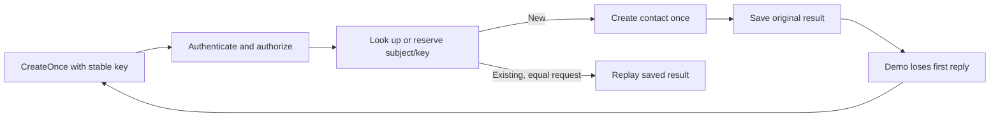

# gRPC resilience: limits, retries, idempotency, and observability

Read [infrastructure](../04-infrastructure/README.md) first. This final stage
starts with a common failure: the server saved a contact, but the client did
not receive the reply. Learn how to repeat the request safely, limit the work
one call can do, and observe the path it took through client and server.

Work through retries, saved results, message limits, and observability one at a
time. The terms and small examples below introduce each idea before its Go code.

## Run from the repository root

```sh
go -C extensions/01-protobuf-and-grpc run ./05-resilience
```

This is a finite controlled-failure lab. It starts its own loopback TLS 1.3
server, generates certificates/tokens in memory, seeds 12 contacts, exercises
the scenarios below, closes channels, joins shutdown, reports telemetry, and
shuts down the SDK providers. It needs no external server, protoc, collector,
or grpcurl. The earlier infrastructure lesson provides separate-terminal modes.
OpenTelemetry API/SDK dependencies are pinned to v1.45.0 in this independent
module; the root course module remains free of these dependencies.

Expected error lines such as `ResourceExhausted` are asserted teaching cases;
the program exits successfully when every scenario behaves as expected.

## Learn in passes

| Pass | Focus | Check your understanding |
| --- | --- | --- |
| 1 | Find `Transient read` and `Lost create reply` in the output. Read the two worked examples below. | Explain why a read can be tried again and why a create needs a stable key. |
| 2 | Follow [client.go](../internal/rpcresilience/client.go), then [idempotency.go](../internal/rpcresilience/idempotency.go). | Find the retry cap, the shared deadline, and the saved result. |
| 3 | Read the four message boundaries and compare the large page with the successful stream. | Explain why many small messages can fit while one large response fails. |
| 4 | Read logs/metrics/traces, then [telemetry.go](../internal/rpcobserve/telemetry.go). | Find one trace ID across several log lines and explain what the counters count. |

On the first pass, focus on these two summary lines among the server logs:

```text
Transient read -> OK after 3 attempts
Lost create reply -> OK after 2 attempts; one contact added, id=13
```

The ID is 13 because the temporary server seeded 12 contacts. Two create RPC
attempts produced one new contact. Understanding that difference is the main
goal of the first two passes. Use the full result table below as you add the
other scenarios:

| Scenario | Expected result |
| --- | --- |
| Two temporary read failures | Third application attempt succeeds. |
| Invalid ID | `InvalidArgument`; one attempt. |
| Lost reply after a create committed | Same key replays the saved result; one contact is added. |
| Same key and payload again | Original contact result is replayed. |
| Same key with another payload | `FailedPrecondition`; no second create. |
| Unary create without a key | `InvalidArgument` on this stage's endpoint. |
| Client/server message limit exceeded | `ResourceExhausted`. |
| Smaller unary page | Success with `next_offset`. |
| Many small streamed contacts | Success, even when aggregate bytes exceed one message's limit. |
| Persistent read outage | Stops after three application attempts. |
| Expired caller deadline | `DeadlineExceeded` without starting another call. |

Read [main.go](main.go), [client.go](client.go), and the narrowly controlled
[fault injector](faults.go), then the policies in
[rpcresilience](../internal/rpcresilience/client.go). Incoming request metadata
cannot enable faults. The lost-reply fixture returns `Unavailable` after a
successful handler/cache result; it models an uncertain outcome without
claiming to simulate packet loss or every failure mode.

## Retry only an operation that can be repeated safely

| Term | Plain meaning | In this demo |
| --- | --- | --- |
| Retry | Try an operation again after a failure. | Make another GetContact RPC after `Unavailable`. |
| Attempt | One try, including the first call. | Three attempts means the first call plus at most two retries. |
| Backoff | Wait before the next attempt. | Wait about 20ms, then about 40ms. |
| Jitter | Vary that wait a little at random. | Different clients are less likely to retry at the same instant. |
| Deadline / budget | The finish time / total time allowed. | All attempts and waits share up to two seconds. |

Follow the first read in the demo:

```text
Input: GetContact(id=1)
Attempt 1: Unavailable -> wait about 20ms
Attempt 2: Unavailable -> wait about 40ms
Attempt 3: contact returned -> OK
```

The contact already existed, and reading it does not ask the server to create
another one. If the server stays unavailable, the loop stops after attempt 3.
If the caller's deadline arrives sooner, that deadline ends the operation.

The teaching client exposes `GetContact`, `ListContacts`, and `CreateOnce`.
Only `Unavailable` is retryable. The maximum is **three application attempts**,
including the first call, with approximately 20ms then 40ms exponential backoff
and +/-20% jitter. A single **two-second deadline** covers connection work,
attempts, and backoff; an earlier caller deadline wins. Cancellation interrupts
the backoff. There is no full new budget per attempt.

Authentication, validation, precondition, capacity, and deadline errors are
returned directly. A read may return fresher data on a later attempt, so safe
repetition does not mean an identical snapshot across attempts. Creation can
be repeated only through the explicitly keyed operation described below.

### After the basic example: retry layers

The connection uses `grpc.WithDisableRetry()` to avoid stacking a configured
gRPC retry policy on the application loop. That option still permits gRPC's
transparent retries before the server processes a call. The three-attempt cap
describes the application loop, rather than every internal connection attempt.
There is no configured replay for other mutations or streaming RPCs. See
[`WithDisableRetry`](https://pkg.go.dev/google.golang.org/grpc@v1.85.0#WithDisableRetry).

gRPC also supports native service-config retry policies. With those policies,
receiving response headers stops further native retries. That rule concerns the
retry engine; it does not establish whether a business write was saved.
The explicit loop here is visible and has one owner; it deliberately makes a
new RPC for each application attempt, even if an earlier attempt sent headers.
Do not combine retry layers without calculating their multiplied work/budgets.
See [retry](https://grpc.io/docs/guides/retry/) and
[service configuration](https://grpc.io/docs/guides/service-config/).

## Idempotency is a server contract, not just a client loop

For creation, trying again has an extra risk: the first request might already
have saved the contact. An **idempotency key** is a label for that one intended
operation. The client reuses the label so the server can recognize the operation.

The **payload** is the request's data, such as `input.name`. The authenticated
**subject** is the verified client identity, such as `writer-client`. Together,
subject and key identify whose operation the server is remembering.

```text
Input: writer-client, key=create-1, name="Retry Contact"
First request: create contact 13 and remember its result; the reply is lost
Second request, same key/data: return saved contact 13; skip the create handler
Result: two RPC attempts, one new contact
```

Here **replay** means returning a saved result. **Deduplication** means recognizing
equivalent requests so the create work is not performed again. Reusing `create-1`
with a different name returns `FailedPrecondition`, because that key already
describes another request. A bearer token proves identity; this key labels work.

The stage-5 endpoint requires exactly one `x-idempotency-key` on unary
`CreateContact`. Valid keys have 1–64 ASCII letters, digits, `_`, or `-`.
`CreateOnce` sets that metadata while copying the caller's outgoing metadata.
It keeps the same key and payload on every retry. The client must not mutate
the request concurrently with a call.

[CreateCache](../internal/rpcresilience/idempotency.go) runs **after**
authentication/authorization. Its index is `(authenticated subject, key)`;
a key cannot bypass permissions or impersonate another subject. The first
request reserves an entry before executing the handler. Concurrent identical
requests wait on that entry instead of repeating its write. Waiting callers
can cancel without canceling the original caller's operation.



Decoded requests are compared with `proto.Equal`, including Protobuf presence
and unknown-field semantics. This comparison precedes domain trimming; changing
the request's whitespace can therefore conflict even if it would normalize to
the same contact. A different payload under an existing key receives
`FailedPrecondition`. Responses are cloned so callers cannot edit cached state.
Replays return the original operation result, even if the contact is later
edited or deleted; they do not fetch current state or recreate a deleted contact.

The cache holds **128 entries**, including terminal error results, for this
server process's lifetime. It has no automatic expiry (TTL) or removal of old
entries (eviction). Once full, it rejects new
keys with `ResourceExhausted`, while existing keys can still replay. Forgetting
old results silently would weaken the guarantee, so this example makes the
capacity tradeoff explicit.

Terminal handler errors are also retained because a generic cache cannot know
whether an error happened before or after an external effect. If the handler
itself returns an ambiguous `Unavailable`, retries replay that error instead
of executing the uncertain write again. The demo's post-commit failure is
outside the cache, leaving the known successful result available for replay.
Changing a key blindly after an error can repeat work; reconcile uncertain state.

This is bounded **in-process deduplication**. The cache and contact store are
separate in-memory components, with no durable transaction across them. Restart,
crash recovery, and multiple replicas need a shared durable idempotency record
committed atomically with the business change for a stronger guarantee.

The metadata contract applies only where this interceptor is installed: stage 5.
Earlier endpoints do not promise deduplication. Keys on other unary methods or
streams are rejected. Client-stream imports still commit one item at a time;
a failed import or canceled stream may already have changed data. A stream's
partial progress is not automatically restarted or rolled back.

## Four explicit message limits

The lab chooses **1,024 bytes** to make limits easy to observe. These are encoded
Protobuf message limits with compression disabled here, separate from contact
field validation, the import's 100-item cap, metadata limits, and aggregate
stream size. The small value is an educational choice, not a deployment default.

| Boundary | Go option | Demonstration |
| --- | --- | --- |
| Client sends | `grpc.MaxCallSendMsgSize` | Reject an oversized request locally. |
| Server receives | `grpc.MaxRecvMsgSize` | Raise only the client limit, then reject before application validation. |
| Server sends | `grpc.MaxSendMsgSize` | Reject a large unary collection response. |
| Client receives | `grpc.MaxCallRecvMsgSize` | Lower one call's limit to reject an otherwise valid contact response. |

A smaller page can fit where the larger page fails. Server streaming sends
contacts individually, so many small messages can exceed 1,024 bytes in total.
A single oversized streamed contact still fails. An import can commit earlier
items before a later oversized request terminates the RPC. Tests verify both
forms of partial progress. Rune limits and byte limits also differ: domain-valid
Unicode text can use enough encoded bytes to exceed the transport policy.

A successful handler log does **not** establish end-to-end delivery. The unary
list handler can return successfully before serialization exceeds the server's
send limit. Its completion log then says OK while transport telemetry/client
status reports `ResourceExhausted`. If only the client receive limit is too low,
the server can complete OK and the client still rejects the response. Examine
the observation point rather than treating these statuses as interchangeable.

## Logs, metrics, and traces

**Observability** means using recorded evidence to understand what the program
did. This lab collects three kinds of evidence with OpenTelemetry:

| Evidence | What it explains | Example here |
| --- | --- | --- |
| Log | One recorded event with details. | A GetContact call finished with `Unavailable`. |
| Metric | A numeric measurement combined across calls. | How many RPC attempts started, or how long calls took. |
| Trace | Related pieces of work connected into one path. | The demo's client RPCs and the server work they caused. |

A **span** records one part of that work with its own start/end and ID, such as
handling GetContact on the server. Spans can have parent spans, allowing a trace
to show which work started other work. Look only at the initial read's three
calls in the demo's trace:

```text
Trace A: resilience-demo
  first GetContact RPC  -> server GetContact -> Unavailable
  second GetContact RPC -> server GetContact -> Unavailable
  third GetContact RPC  -> server GetContact -> OK
```

This is a simplified view; the instrumentation also records client attempt
spans. All three RPCs share the demo's trace ID, but each span has a different
span ID. The attempt counter increases three times. The log for each server
call has the same trace ID so you can connect it to this path.

| Identifier | What it labels | When it is reused |
| --- | --- | --- |
| `x-request-id` | One RPC for finding its log entries. | The response echoes it. The demo generates a new one for each RPC when the client supplies none. |
| `x-idempotency-key` | One intended create operation. | The client keeps it across retries of that same create. |
| `trace_id` | A group of related work. | Client/server spans in that trace share it. |
| `span_id` | One part of that work. | Child spans refer to the parent's ID; each span has its own ID. |

### Follow the collected data into the Go code

The OpenTelemetry **SDK** (software development kit) is the library that records
and combines these observations. A **provider** supplies the recorders for
metrics or the tracers that create spans. An **exporter** receives data for storage or
delivery. A **collector** is an optional separate process that receives exported
telemetry; this example stores data locally and needs no collector process.

[rpcobserve](../internal/rpcobserve/telemetry.go) configures the official gRPC
OpenTelemetry instrumentation with providers owned by this run. It installs no
global providers. SDK metrics use a manual reader, and trace context propagates
over gRPC with W3C Trace Context. Client and server spans share a trace ID and
record their parent relationships. Completion logs add `trace_id`/`span_id` when
a span is present, while retaining stage 4's request ID.

A **manual reader** lets this program ask the SDK for its current measurements
by calling `Collect`. There is no periodic network export in this example.

The summary includes instruments such as `grpc.client.attempt.started`,
`grpc.client.call.duration`, and `grpc.server.call.duration`. Each application
retry is a **new gRPC call** in this implementation, so one helper operation
can contribute several observations. The root `resilience-demo` span groups
the finite run; each RPC has its own client/attempt/server spans. Transport
metrics can report failures that occur before a unary interceptor runs.

A duration line with `observations=N` counts recorded duration samples; it does
not print N seconds. The report combines all scenarios, so its counts include
more calls than the three attempts of the initial read. `Collect` exposes the
full measurements if you want to inspect durations and outcomes individually.

Metric **labels** describe a measurement, such as its RPC method and status.
Each distinct combination is a **series**. Giving every request ID its own label
would keep creating new series as requests arrive; this is why the label choices
matter for memory and cost.

Method labels use the known contact/health method set, with unknown names
bucketed as `other`. Request IDs, keys, credentials, and contact fields are
not metric labels. The local exporter retains only the first **256 span
summaries**, counts dropped summaries, and excludes payloads, raw metadata,
status descriptions, and event lists. Snapshots are independent copies.
Always-sampling and synchronous local export keep this finite lesson inspectable;
production sampling, exporter queues, collectors, and retention require separate
configuration. This buffer cap does not bound the contact store or all SDK memory.

OpenTelemetry API/SDK v1.45.0 matches the versions required by gRPC v1.85.0.
The pinned gRPC release still exposes trace options through an experimental
configuration type; the example records that dependency explicitly. See the
[gRPC metrics guide](https://grpc.io/docs/guides/opentelemetry-metrics/) and
[Go instrumentation guide](https://opentelemetry.io/docs/languages/go/instrumentation/).

## Final review

After working through the examples, run the checks:

```sh
go -C extensions/01-protobuf-and-grpc test -count=1 -timeout=30s ./...
go -C extensions/01-protobuf-and-grpc test -race -count=3 -cpu=1,2 -timeout=45s ./...
go -C extensions/01-protobuf-and-grpc vet ./...
go -C extensions/01-protobuf-and-grpc mod tidy -diff
```

The [review and validation guide](review.md) maps all five stages, their checks,
and the limits of the completed educational scope. Before finishing, explain
why `Unavailable` alone cannot make a write safe to retry, why a key must be
bound to a payload and authenticated subject, why message limits do not cap
an entire stream, and why handler/client/transport outcomes can differ.
