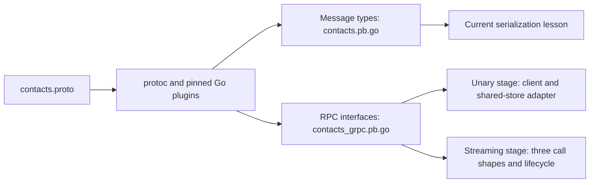

# Protobuf and gRPC: contacts lab

This optional backend extension follows the course's
[REST fundamentals](../../chapters/13-standard-library/06-project-rest-api/README.md).
It is supplementary material, outside the book's numbered chapter mapping.
Read packages, interfaces, errors, concurrency, context, testing, and REST first.

The lab has its own module so external Protobuf/gRPC/database dependencies do not enter
the main course module. Use Go 1.27. The first run downloads pinned dependencies;
subsequent runs can reuse the module cache. Generated source is checked in, so
running the lesson and ordinary tests does not require protoc.

## Available stages

The implemented first stage provides a versioned `.proto` contract, generated
message types and gRPC interfaces, a finite local serialization demo, and tests
for presence, masks, wire compatibility, and cloning. This first lesson works
locally. The [second stage](02-unary/README.md) now implements the six unary RPCs
with a shared-store adapter, real client/server demos, status errors, contexts,
and in-memory/TCP integration tests. The [third stage](03-streaming/README.md)
adds server streaming, bounded client-stream imports, and bidirectional lookups
with per-item outcomes, cancellation, flow control, and lifecycle tests. The
[fourth stage](04-infrastructure/README.md) adds metadata, interceptor chains,
completion logging, verified TLS, reader/writer access, health, reflection, and
grpcurl exercises around the same service. The [fifth stage](05-resilience/README.md)
completes the in-memory sequence with byte limits, bounded retries, keyed creation, local
OpenTelemetry metrics/traces, controlled failures, and a [final review](05-resilience/review.md).

The [sixth stage, gRPC with PostgreSQL](06-postgres/README.md), follows the SQL
lessons and REST with PostgreSQL. It reuses their persistent store for unary and
streaming RPCs, commits keyed creations/results atomically, and verifies recovery
across server/pool/process lifetimes. It keeps TLS, permissions, bounds, discovery,
and owned telemetry. All six stages are implemented.

Start with the [dedicated Protobuf lesson](01-protobuf/README.md), then follow
the short passes in each stage's guide. Read the worked request/result examples,
follow their code, and finish with the operational details. The
[unary](02-unary/README.md#learn-in-passes),
[streaming](03-streaming/README.md#learn-in-passes),
[infrastructure](04-infrastructure/README.md#learn-in-passes), and
[resilience](05-resilience/README.md#learn-in-passes) guides define new terms
where they first become useful.

From the repository root:

```sh
go -C extensions/01-protobuf-and-grpc run ./01-protobuf
go -C extensions/01-protobuf-and-grpc run ./02-unary
go -C extensions/01-protobuf-and-grpc run ./03-streaming
go -C extensions/01-protobuf-and-grpc run ./04-infrastructure
go -C extensions/01-protobuf-and-grpc run ./05-resilience
go -C extensions/01-protobuf-and-grpc test -count=1 -timeout=30s ./...
go -C extensions/01-protobuf-and-grpc vet ./...
go -C extensions/01-protobuf-and-grpc mod tidy -diff
```

The demo prints a successful binary round-trip, ProtoJSON with a string ID,
absent versus explicitly empty optional versions, a mask selecting an empty
email value, and an independently edited clone. These are executable concept
examples, rather than serialization benchmarks.
The unary, streaming, infrastructure, and resilience demos start temporary local
servers, make real RPC calls, and shut down automatically. Stages 2-4 also offer
separate server/client modes; stage 5 runs controlled finite scenarios.
The infrastructure demo creates its temporary CA,
certificates, and credentials in memory; ordinary runs need no external tools.
The resilience lesson also collects local metrics/traces without a collector.

After the [SQL prerequisites](06-postgres/README.md), start the dedicated lab
database, set `DATABASE_URL`, and run
`go -C extensions/01-protobuf-and-grpc run ./06-postgres`.
Its finite and separate-process modes are documented in
[gRPC with PostgreSQL](06-postgres/README.md). Ordinary tests compile all stages
without a database; select `-tags=integration` to run real PostgreSQL contracts.

## Read in order

Use the [five foundation passes](01-protobuf/README.md#learn-in-passes) for the
first lesson. When inspecting how its contract, demo, tests, and generated code
fit together, use this source map:

1. [contacts.proto](proto/contacts/v1/contacts.proto): the versioned package,
   field numbers, messages, enums, optional field, field mask, and service.
2. [main.go](01-protobuf/main.go): each numbered example constructs messages
   and exercises the relevant encoding or ownership rule.
3. [main_test.go](01-protobuf/main_test.go): observable contracts, including an
   existing binary fixture and a simulated future unknown field.
4. [contacts.pb.go](gen/contacts/v1/contacts.pb.go): generated message types,
   getters, presence storage, and descriptors. Inspect it; edit the `.proto`.
5. [contacts_grpc.pb.go](gen/contacts/v1/contacts_grpc.pb.go): generated client
   and server interfaces, method names, and registration code. Generation does
   not implement application behavior; the default server methods return
   `Unimplemented` until the transport adapter supplies them.

The Protobuf package `contacts.v1` identifies the wire contract. `go_package`
separately specifies the generated Go import path and package name. The module's
`example.com` path is a local teaching identity, not a published service.

## What Protobuf and gRPC each provide

Protobuf describes structured messages and their binary encoding. gRPC adds a
remote-call contract and transport machinery. Generated methods make invocation
typed, while real calls still need deadlines, cancellation, failure handling,
and connection ownership. ProtoJSON is an additional representation for
inspection or interchange; this lab's gRPC calls use Protobuf binary.



| Defined unary RPC | Intended service behavior |
| --- | --- |
| `CreateContact` | Validate editable input and assign a stable ID. |
| `GetContact` | Retrieve a contact and its opaque version. |
| `ListContacts` | Filter, order, and paginate; zero limit selects 20, maximum is 100. |
| `ReplaceContact` | Replace every editable field of an existing contact. |
| `UpdateContact` | Change only writable fields selected by a required nonempty mask. |
| `DeleteContact` | Delete an existing contact and return a dedicated empty response. |

The [unary adapter](rpcapi/service.go) enforces these semantics using the
[shared contact rules](../../chapters/13-standard-library/06-project-rest-api/contacts/model.go).
No domain validation runs merely because a protobuf message was decoded.
Negative IDs, absent input messages, and blank names need service validation.
Strings must still contain valid UTF-8 for proto3 encoding.

The [streaming adapter](rpcapi/streaming.go) adds `StreamContacts` (one snapshot
page), `ImportContacts` (at most 100 sequential creates with partial commits),
and `LookupContacts` (bidirectional replies using a `oneof` outcome). See the
[streaming guide](03-streaming/README.md) for ordering, half-close versus final
status, item versus RPC failures, and bounded application work.

## Presence and partial updates

Plain proto3 strings use implicit presence: missing and explicitly empty text
read as `""`. This fits the shared store's optional email/phone values. The
required name remains a business rule, rather than a protobuf `required` field.

An `optional string expected_version` retains presence. In this generated Open
Struct API, nil means absent, while `proto.String("")` is present and empty.
Both getters return `""`, so the service must inspect presence before choosing
unconditional behavior. A present empty version is invalid under this contract.
The version is copied from a Contact, not constructed from an HTTP ETag.

`UpdateContact` requires both `input` and `update_mask`. Allowed paths are
`name`, `email`, and `phone`, without duplicates, wildcards, or nested paths.
Unselected fields are ignored. Selecting email while its value is `""` requests
clearing it, even though a plain zero-valued string can be absent from the wire.
Selecting blank name must fail validation. An absent or empty mask is invalid;
full replacement has its own `ReplaceContact` operation.

This differs from REST's Merge Patch null-removal syntax. In this contract,
selection comes from a `google.protobuf.FieldMask` and clearing comes from the
selected field's empty value. ProtoJSON represents a field mask as a string
such as `"email,phone"`, and int64 IDs as JSON strings. Use `protojson` for
generated messages; `encoding/json` does not implement the Protobuf JSON rules.

## Ownership and compatibility

Use pointers to generated messages. Their structs contain runtime state;
ordinary struct copying is not a deep clone. Use `proto.Clone` before independent
edits and `proto.Equal` for message equality. Sharing a message while another
goroutine edits it requires an explicit synchronization/ownership policy.

Field numbers identify binary fields. Preserve existing numbers and compatible
types. Never reuse a retired number or name; the contract reserves number 6 and
`legacy_notes` as a teaching example. Binary-compatible evolution also needs
care with application meaning, enum defaults, and client expectations. Renaming
fields can break JSON consumers even when the binary field number stays stable.

Unknown binary fields are preserved by ordinary Go binary decoding/re-encoding.
The test appends a future field to demonstrate that behavior. A ProtoJSON
conversion does not preserve those unknown binary fields, and ProtoJSON rejects
unknown JSON members by default. Do not equate JSON and binary compatibility.
Protobuf serialization is not a universal canonical byte format; the tests use
semantic equality except where checking a specific established wire fixture.

## Regenerate reproducibly

The source of truth is the `.proto` file. Record changes there and regenerate
both Go outputs; do not edit the generated files manually. The recorded tools:

| Tool | Pinned version |
| --- | --- |
| Go module | Go 1.27 |
| protoc compiler | CLI output `libprotoc 35.1` |
| Go Protobuf runtime and `protoc-gen-go` | `v1.36.12` |
| gRPC-Go runtime | `v1.85.0` |
| `protoc-gen-go-grpc` | `v1.6.2` |
| Stage-5 OpenTelemetry API/SDK | `v1.45.0` |

Install the recorded compiler with its standard `.proto` includes using the
[official installation instructions](https://protobuf.dev/installation/).
The generator verifies the compiler version and builds Go plugins from module
tool dependencies into temporary storage, using the versions in
[go.mod](go.mod) and [go.sum](go.sum). It does not install plugins globally.

```sh
go -C extensions/01-protobuf-and-grpc generate .
go -C extensions/01-protobuf-and-grpc run ./internal/cmd/protogen -check
```

The second command regenerates in a temporary directory and compares the two
outputs without changing checked-in generated files. It reports differences
with an instruction to regenerate. Both commands need the compiler and pinned
plugins; ordinary tests remain independent of compiler availability.

[protogen](internal/cmd/protogen/main.go) finds well-known definitions beside
the resolved compiler installation. For a different installation layout:

```sh
go -C extensions/01-protobuf-and-grpc run ./internal/cmd/protogen \
  -check -include /absolute/path/to/protoc/include
```

## Stage status

| Stage | Status and scope |
| --- | --- |
| 1. Protobuf foundation | Implemented: contract, generated bindings, presence, masks, local serialization, compatibility examples, reproducible generation. |
| 2. Unary application | Implemented: [shared-store adapter and client/server demos](02-unary/README.md), typed status errors, channel ownership, deadlines/cancellation, graceful/forced shutdown, and bufconn/TCP/shared-REST tests. |
| 3. Streaming | Implemented: [three streaming call shapes](03-streaming/README.md), completion versus failure, partial imports, item outcomes, cancellation/deadlines, ordering, bounded work, flow control, and active-stream shutdown tests. |
| 4. Service infrastructure | Implemented: [metadata and interceptor chains](04-infrastructure/README.md), completion logging, verified TLS, reader/writer authentication/authorization, health Check/List/Watch and shutdown, opt-in reflection v1/v1alpha, and [grpcurl exercises](04-infrastructure/grpcurl.md). |
| 5. Resilience and final review | Implemented: [four message boundaries, three-attempt retry budgets, subject-scoped idempotency, OpenTelemetry, and failure tests](05-resilience/README.md), plus [end-to-end review/validation](05-resilience/review.md). |

All five agreed stages are implemented. Keep the examples separate so
serialization concepts remain readable before transport and operational behavior
are introduced. Load balancing, gateways,
and deployment-specific integration can follow as optional deeper exercises.

References: [gRPC Go quick start](https://grpc.io/docs/languages/go/quickstart/),
[proto3 language guide](https://protobuf.dev/programming-guides/proto3/),
[field presence](https://protobuf.dev/programming-guides/field_presence/),
[Go generated-code guide](https://protobuf.dev/reference/go/go-generated/),
[FieldMask](https://protobuf.dev/reference/protobuf/google.protobuf/#field-mask),
[ProtoJSON](https://protobuf.dev/programming-guides/json/), and
[Go tool dependencies](https://go.dev/doc/modules/managing-dependencies#tool-dependencies).
